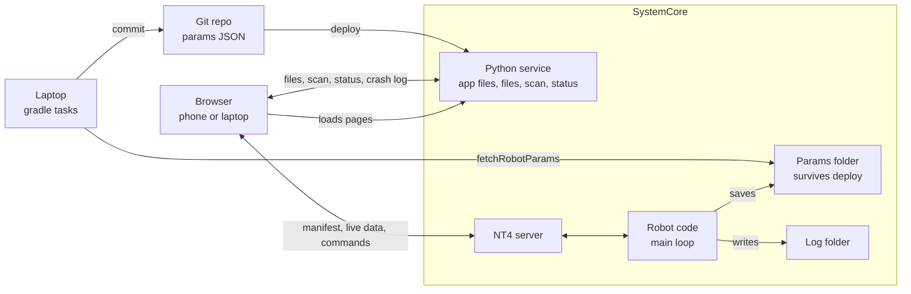

# FM Robot App on SystemCore

Plan from 2026-09-24. Status: first cut in `src/main/deploy/app/`, read-only to the robot (see
[What the first cut covers](#what-the-first-cut-covers)). Being replaced by the Robot App brief
(`concepts_brief.md` on branch `ccr-78e179ce-f84m7v`): on FM's SystemCore the first cut can't serve
on 5800 (below), and the brief installs the app as a SystemCore package instead.

## Summary

The FM robot will serve its own pit web app from the SystemCore, as plain HTML and JavaScript files deployed with the robot code. Three rules keep it from going stale the way the old `tools/robot-app` did:

- **The robot serves the app.** Every `./gradlew deploy` ships the app and the code together, so the two always match.
- **The robot describes itself.** Pages read mechanism names, limits, CAN IDs and NT keys from a manifest the code publishes, not from copies kept in the app.
- **The app writes JSON, never Java.** Tuned values land in small data files, and a gradle task pulls them into git.

| Decision | Choice |
| --- | --- |
| Where the app runs | On the robot, served by a separate Python service (launcher `.ipk`); files ship from this repo (`src/main/deploy/app/`) with every deploy |
| Build step | None for laptops (no npm). Gradle generates a committed module into `app/` from the Java (params, manifest fields, bindings); CI checks it is fresh |
| What a laptop needs | WPILib only (plus Python for the existing `tools/`); no Node |
| How the app changes robot behavior | NT commands, handled by the main loop as logged inputs |
| Camera mounts | Repo JSON is the source of truth, pushed to the cameras, calibrated from field tags |

The code referenced here is on [`port/fm-2027` (PR #1)](https://github.com/Spectrum3847/2026-FM-SystemCore/pull/1) and the PRs built on it. The old app is [`tools/robot-app`](https://github.com/Spectrum3847/2026-Spectrum/tree/2026-offseason-bot/tools/robot-app) on 2026-Spectrum's `2026-offseason-bot` branch.

## Why the old app went stale

Everything that broke was a fact about the robot that the app kept its own copy of. When the robot code changed, the copy didn't.

| The app's own copy | Where it broke on FM-SystemCore |
| --- | --- |
| roboRIO addresses, the `lvuser` account, `/home/lvuser/logs` | SystemCore uses `robot.local`, the `systemcore` user, and `/U/logs` or `/home/systemcore/logs` |
| A rewrite of `configEncoderOffsets(...)` in `OM2026.java` and of the `LimelightConfig` chains in `Vision.java` | FM uses `FM2026.java`, and `VisionConfig` has different fields (`systemCoreCameras`, `orinRobotToCamera`) |
| NT key names under `/Robot/Swerve/Align/` (the old DogLog logging library) | AdvantageKit publishes under `/AdvantageKit/RealOutputs/…`, and `DashboardReceiver` only sends dashboard keys to NT |
| `robot-profile.json` (CAN IDs, current limits) and `controls.json`, mirrored by hand from Java | The drift check reads Java with a custom parser and only shows a warning banner |
| Lived in one repo's `tools/` folder | Wasn't brought over; FM's README lists it as a known gap, and `SwerveAlignment.java` still points at a `tools/swerve-align` that doesn't exist |
| Needed Node, `npm install` and a Vite build on each laptop | Could serve an out-of-date build (its README describes the bug) |

**Worth keeping from it:**

- The browser talks to the robot and cameras directly: NT4 over WebSocket (`nt4.js`) and the Limelights' own HTTP API (`limelight.js`).
- `wpilog.js`, a log reader that runs in both the browser and Node, and `log-model.js`, which finds mechanisms in a log on its own.
- The Power page: current against each motor's limit, time pinned at the limit, battery sag, pack internal resistance, energy per mechanism, and a main-breaker heat simulation.
- The CAN page, and the camera calibration from each camera's accelerometer and an AprilTag solve.
- Tests pinned to real robot data: camera frames from 2026-09-07 and committed match logs.
- The turret page's habit of listing any log key it has no view for, so new checks show up without editing the app.

## Architecture

The robot holds the app, the facts and the live values; the laptop only does git work.



Pages load from the robot, talk to the code over NT, and never touch files; the laptop moves tuned values into git.

### 1. The robot serves the app

- The app is served by a separate Python service (a launcher-only `.ipk`), not by `WebServer` inside the robot program. That is what lets it keep working when the robot program has crashed or is in a crash loop, and it avoids the SystemCore port-5800 collision. The files live in `src/main/deploy/app/` and ship with every deploy.
- The service port is a setting, picked from a free port in the 5800s; nothing in the app hard-codes it.
- Same origin as the robot, so no address probing, no `config.local.json`, no log-folder settings.
- `WebServer` is still started in sim (guarded) for dev and Playwright tests; on a laptop, serve the folder with `jwebserver` from the WPILib JDK. Production on a real robot is always hosted on the robot.

### 2. The robot publishes a manifest

Built at startup from objects the code already has, replacing `robot-profile.json`:

- Each `Mechanism`: name, CAN IDs, bus, followers, supply and stator current limits, soft limits.
- Swerve alignment: `SwerveAlignment.KEY_PREFIX` and `MODULE_NAMES`.
- Cameras from `VisionConfig`: names, hosts, mounts.
- The log folder, `LogStorage.folder()` (PR #6), and the robot identity.

It goes on NT for live pages, and into the log once at startup for log pages. It has to be a logged output rather than metadata: AdvantageKit only takes metadata before `Logger.start()`, and the mechanisms don't exist yet. GitSHA, GitDirty and RobotIdentity are already metadata.

For `controls.json`: put a one-line description next to each binding in Java. The wording stays hand-written, as the old README wanted, but sits where anyone editing the binding sees it.

### Generated contract (new)

Gradle generates a committed module into `src/main/deploy/app/` from the Java: the params schema, the manifest fields, and the button bindings. Pages import it instead of hard-coding keys, prefixes or module lists. CI runs the generator with `--check` and fails a PR that leaves it stale, the same way `make_log_key_guide.py` guards `log-keys.json`. The generic generation machinery lives in `spectrumLib` (it moves with that library next year); the robot-specific field set stays in this repo. Pages that need a key the module doesn't list must add it to the Java side in the same PR.

### 3. Tuned values live in JSON

Only the numbers the app writes move out of Java, into `src/main/deploy/params/` (`spectrumLib/params`):

| File | Replaces |
| --- | --- |
| `swerve.json` | `swerve.configEncoderOffsets(...)` in `FM2026.java` |
| `soft-limits.json` | e.g. `minRotations` / `maxRotations` in `Hood.java` |
| `cameras.json` | `systemCoreCameras`, `orinRobotToCamera` and the Limelight mounts in `VisionConfig` |

Everything else stays in Java. The Java rewriters (`swerve-config.js`, `vision-config.js`) and their Spotless workarounds are deleted.

### 4. Changes go through NT, as logged inputs

- AGENTS.md: logic reads only logged inputs, and `Logger` is main-thread only. A web request handled on its own thread would break both.
- `TuneValue` already works this way (it's built on `LoggedNetworkNumber`). Buttons like "Capture offsets" or "Set soft max" publish to NT; the main loop acts on them, so replay sees exactly what happened.
- Changes are refused unless the robot is disabled.
- `nt4.js` is read-only today and needs to publish.

### 5. Git work stays on the laptop

Gradle tasks, matching the existing `ntDump`, `-ProbotLog` and `-ProbotTop`:

- `pullTuning`: copies the robot's overrides into the repo JSON.
- A deploy check: stops if the robot has changes nobody has pulled.
- Log sync to [2026-Robot-Logs](https://github.com/Spectrum3847/2026-Robot-Logs), keeping the old app's headline-numbers `manifest.json`. Gradle or Python, since `tools/` already needs Python.

## Tuning flow

Params sync v2, cut to the three rules plus the ancestry check (decision 1). A value tuned in the pit is live on the robot at once, and only becomes permanent when `applyRobotParams` puts it in git.

1. **Tuning mode.** A website request turns tuning on and off at runtime (no compile-time `TUNING_MODE` gate); it is off when FMS is attached and ignored while enabled. Changes apply on the main thread only while disabled with no field, and are logged as inputs. Hard-stop changes are confirmed by a click on the page, with no controller required.
2. **Tune.** A page sends an NT command while the robot is disabled. The main loop applies it where it can (TalonFX soft limits at once; swerve offsets on the next restart). It saves an override recording `value`, `baseDeployedValue`, `savedAtEpoch` and `_meta` (`savedAtGitSha`, `hardwareStamp` for `swerve` and `soft-limits`).
3. **Replay.** The effective tuning is logged as an input when it loads. Replay on the PC uses the logged values; the PC has no override files.
4. **Fetch.** `fetchRobotParams` reads `/home/systemcore/params/` over SSH into `.robot-inbox/<robot>/` (git-ignored, so `eventDeploy` never stages it). It never writes to the robot and never blocks a deploy if the robot is unreachable.
5. **Promote.** `applyRobotParams` (or an AI session following AGENTS.md) reads the inbox, including superseded entries. Clean overrides (base equals the working-tree value, not saved on a dirty deploy) are written into the tracked params files for `git diff` review. Dirty-deploy saves, conflicts and hard-stop groups need a person's confirmation; hard-stop changes also get the AGENTS.md PR block (old value, new value, failure mode).
6. **Boot reconciliation (three rules, first match wins).** Hardware-stamp mismatch refuses the file and alerts; `baseDeployedValue == deployedValue` keeps the override; otherwise the deployed value wins and the robot's old value stays recoverable from `.robot-inbox/`. Plus an ancestry check: the deployed value wins if the commit the robot was tuned on is an ancestor of the deployed code; otherwise the robot value stays, with a warning. Resolved values and their sources are logged as AdvantageKit inputs.
7. **Deploy check.** If the robot has overrides not in the repo, deploy stops and lists them (e.g. `hood.softLimitMax 0.137 -> 0.141, tuned 9/24`); `-PdiscardTuning` throws them away on purpose.

The existing `eventDeploy` auto-commit on `event*` branches picks up the pulled JSON with no extra step. Clocks are never used to decide which value wins; time is display-only (`savedAtEpoch`, "saved 12 min ago"), and a save with no valid clock records `null`, never 1970.

## Pages

Most pages port from the old app; soft limits and the on-robot Logs page are new.

| Page | What it does | Writes | Source |
| --- | --- | --- | --- |
| Swerve Align | Live CANcoder angles (already published by `SwerveAlignment` at 20 Hz while disabled). Set wheels straight, press Capture. | `swerve.json`, applied on next restart | Port; keys from the manifest |
| Soft Limits | Robot disabled, motors in coast, move by hand, watch position, press "Set min" / "Set max". Shows observed range from recent logs beside the limits. | `soft-limits.json`, applied to the TalonFX at once | New |
| Cameras | Live view, pitch / roll / height from accelerometer and tag solve, image settings and the auto-tune sweep | `cameras.json`, pushed to cameras | Port |
| Logs | Lists `LogStorage.folder()` with date, size and match; download, zip a day, open in Power or CAN; file browser over SystemCore | Nothing (download/upload via the service) | New |
| Power | Current vs limit, time at limit, sag, internal resistance, energy per mechanism, breaker heat | Nothing | Port; limits from the log's manifest |
| CAN | Bus use, error counters, dropouts, device list, broken down by mechanism | Nothing | Port; add SystemCore's native buses (PR #2) |
| Network | Scans the robot subnet on demand, identifies devices by open ports/services (Limelight, PhotonVision, laptop, radio); simpler themed view replacing radio config pages | Nothing | New |
| Status / Crash | Robot program running/crashed, crash log tail, CPU, temps, process list; pages grey out when NT or the program is down | Nothing | New |
| Pilot / Operator | Button maps and live controller diagram | Nothing | Port; descriptions from the manifest, joystick data from NT |
| Tuning | Params manifest, live edits, save, hard-stop confirmation by click | Params via NT / SaveParams | New |

The Turret page is dropped (FM has a hood, not a turret), but its "list every key without a view" pattern is reused on every log page.

**Cameras.**

- Repo JSON is the source of truth and `pushLimelightMounts` gets turned on, the same as the offseason robot. This clears the README's pre-event item "verify, then turn it on".
- The tag solve measures pitch, roll and height. Forward, right and yaw need a known robot position; a later "known spot" mode could solve all six with the robot parked on a marked field position.
- Open: also keep exposure, sensor gain and black level in `cameras.json` and push them, so a replacement camera gets the same image settings?

**Logs and power.**

- Logs are read in the browser, in a background worker, so the robot does no parsing. The same pages can open a `.wpilog` from the laptop. The Python service streams log files itself (proxied, chunked) and can zip a day; it does not buffer whole logs in memory on the 4 GB controller.
- `MotorInputs` now logs `followerSupplyCurrentAmps[]` and `followerConnected[]`. That removes two of the old README's warnings: leader-only current readings, and dead followers that didn't show up.
- Each log carries its own manifest, so old logs still display correctly after the code changes.

## Plain HTML and JavaScript

Plain files cover everything the old app did. "No build" means no compile step, not no libraries: each library is one file saved in the repo.

### What it can do

- **Code organization:** native JavaScript modules (`import` between files), import maps so `import … from "chart.js"` loads the saved copy, and background workers for parsing big logs.
- **Type checking without TypeScript:** `// @ts-check` plus JSDoc comments. VS Code flags mistakes as you type, and CI runs `tsc --noEmit`.
- **UI:** plain DOM helpers (the old app's `el`, `mountHeader`), Web Components for shared widgets, and Preact + htm or Lit as single files if a page gets complicated.
- **CSS:** custom properties (the theming already uses them), native nesting, grid, container queries, dark mode. No Sass.
- **Graphics:** Chart.js (its single-file build) or uPlot; Canvas and SVG for module dials, the controller diagram and a field view; Three.js if the 3D FM model (`Robot_FM/model.glb`) is ever wanted.
- **Robot and cameras:** NT4 over WebSocket, `fetch` to the robot and to the Limelights' HTTP API, and live video with a plain ``.
- **Files:** open a `.wpilog` from the laptop, save logs, CSV or JSON to the PC, zip a day's logs (one small library such as fflate), cache opened logs in IndexedDB, print a checklist or match report.

### What's blocked from `http://robot.local`

Browsers only allow some features on HTTPS or localhost pages, and the robot's page is neither.

| Blocked | Workaround |
| --- | --- |
| Writing to a folder on the PC | `./gradlew pullTuning` |
| Gamepad API (browsers are restricting it) | Joystick data from SystemCore's system NT server, which also shows what the robot actually receives |
| Copy-to-clipboard API | An older fallback still works |
| Installing as an offline app; keep-screen-on | Not needed; the robot serves the page, and a bookmark works |

If one of these is ever needed, serve the same files from localhost on the laptop with `jwebserver`, which comes with the WPILib JDK.

### What still needs robot code or the laptop

- **Listing files on the robot:** the Python service browses SystemCore's filesystem directly (download and upload), so WinSCP is not needed. NT is not involved.
- **Changing anything on the robot:** an NT command the main loop handles and logs.
- **SSH and git:** gradle tasks on the laptop.

### Folder layout

```
src/main/deploy/app/
  index.html, styles.css, version.js (stamp written by gradle)
  vendor/   chart.umd.min.js, fonts, other libraries as single files
  lib/      wpilog.js, log-model.js, nt4.js, camera-cal.js, charts.js, ui.js
  pages/    swerve-align/, soft-limits/, cameras/, logs/, power/, can/, controls/
```

The existing `WebServer` serves this at `http://robot.local:5800/app/`. Keep `lib/` logic free of page code, so `node --test` runs the same files in CI.

### The one way plain files can still go stale: the browser cache

After a deploy, a browser may keep running JavaScript it cached earlier.

- No `version.js` stamp is needed: both `WebServer` (sim) and the Python service (production) send `Cache-Control: no-store, no-cache`, so a deploy is never masked by a stale browser cache. If that ever stops being true, the stamp comes back.

## Keeping it in sync with AI and human edits

Most drift disappears by design; a CI check on PRs catches the rest, and nothing ever blocks a deploy.

The design removes the old causes: the app parses no Java and keeps no copies of robot facts. It also has no addresses to configure. What's left is the contract between pages and the robot: the manifest fields and log keys each page reads.

**Each page declares what it needs.** A short list at the top of its `main.js` names the manifest fields and log keys it reads. The CI check and the runtime banner both read that list.

**CI check (GitHub Actions, on PRs only).** This keeps the old app's rule that nothing may fail a build or block a deploy.

1. Run the scripted sim: `FM_SIM_SCRIPT=drive ./gradlew simulateJava -PnoSimGui`.
2. Run `log-model.js` in Node against that log and its manifest. Fail if a page's required key is missing, with a message like `power: hood missing SupplyCurrent`.
3. Run the existing tests: committed match logs, camera fixtures, the power math.
4. Run `tsc --noEmit` for the JSDoc types.
5. Later: load each page in Playwright against the sim, served by `WebServer` in sim or by `jwebserver` for laptop dev.

**Runtime banner.** A page missing something it needs shows a warning and keeps working, like the old app's `/api/drift` banner.

**Rules for AGENTS.md:**

- To add a tuned value, declare it in Java (`Params.group(...)`) and add it to `src/main/deploy/params/*.json`. Don't touch `app/` for it.
- Never put Java file paths, NT key strings or CAN IDs in `app/`. Read them from the manifest.
- The app changes the robot only through NT commands, handled on the main thread, logged as inputs. Tuning applies only while disabled with no FMS attached; tuning mode itself is toggled from the website at runtime, with no compile-time gate. Guided procedures may need utility mode, but the page never commands motion.
- New libraries go in `app/vendor/` as single files. No npm, no build step.
- A PR that renames a manifest field or log key a page needs updates that page's list in the same PR.

## Build order

Steps 1–5 are realistic before the October event; 6 and 7 can wait. Build on `port/fm-2027`; the Logs page needs `LogStorage` from PR #6. One feature per PR, per AGENTS.md.

- [x] **1. Trial run.** Swerve Align is plain files in `src/main/deploy/app/`. Its NT prefix is still a constant in the page; the generated module replaces it. Phone access still needs the bench.
- [ ] **2. Python service (launcher `.ipk`).** Separate process serving `src/main/deploy/app/` on a configurable port, with `Cache-Control: no-store, no-cache`, crash-status and file-browser endpoints, and the on-demand network scan. `WebServer` stays in sim only.
- [ ] **3. Generated contract.** Gradle task emitting a committed module (params, manifest fields, bindings) into `app/`; CI freshness check; `lib/nt4.js` keeps per-topic last-update time.
- [ ] **4. Manifest.** Build it from `Mechanism`, `SwerveAlignment`, `VisionConfig` and `LogStorage`. Publish on NT and log it once at startup.
- [ ] **5. Tuning JSON.** `swerve.json`, `soft-limits.json`, `cameras.json`; the loader with overrides and the bad-file alert; NT commands; runtime tuning toggle; hard-stop confirmation by click; effective tuning logged as an input. Turn on `pushLimelightMounts`.
- [ ] **6. Params sync.** `fetchRobotParams`, `applyRobotParams`, boot reconciliation (three rules + ancestry), deploy check, inbox under `.robot-inbox/`.
- [ ] **7. Pit pages.** Soft Limits, Cameras (port), Logs with downloads and file browser, Network, Status/Crash.
- [x] **8. Log pages.** Port Power and CAN, with SystemCore's native buses and per-mechanism breakdown.
- [ ] **9. Upkeep.** The CI check (scripted sim + generated-module freshness + `tsc --noEmit`), AGENTS.md rules, log sync to 2026-Robot-Logs, Pilot / Operator page, and Playwright against `jwebserver` + sim.

## What the first cut covers

The pages in the table above, minus Soft Limits, Network, Status/Crash, Tuning and Pilot / Operator, with these limits:

- **Read-only to the robot.** No manifest, no tuning JSON, no NT commands, no params sync. Swerve Align and Cameras print the Java line to paste; Cameras can also save a mount or image setting to the camera's own flash.
- **No robot facts in the app.** Mechanisms, CAN buses and cameras are found from the log or from NT announcements. Current limits are not logged, so Power shows no limit lines until the manifest carries them.
- **Logs come from the laptop.** The Logs, Power and CAN pages open a `.wpilog` with a file picker.
- **Tests** in `tools/app-test/` run with `node --test` in the CI `app` job. They include a check that every relative import and link resolves. The old app's code is not carried over; this app is built fresh.

Steps 2 to 7 and 9 remain.

## Check on the bench first

None of these should change the plan, but each one could change a detail, so check them during step 1.

- [x] **Port 5800 / hosting.** Resolved: the app is served by a separate Python service on a free port in the 5800s (a setting), not by `WebServer` on 5800, which collides with SystemCore's `visionserver` (5800, 5802, 5805-5807) and Limelight streams. Verified on FM 2026-10-29: ports in use 5800-5803, 5805-5807, 5810, 5812, 5815-5817, 5819, 5820, 5822, 5825-5827, 5832, 5835-5837.
- [x] **Cache headers.** The Python service must send `Cache-Control: no-store, no-cache` on every response, matching `WebServer`'s behavior, so a deploy is never masked by a stale browser cache. `WebServer` in sim already does this, so the `version.js` stamp is not needed.
- [x] **`WebServer` behavior (sim/dev only).** From the allwpilib source (`wpinet` `WebServer.cpp` and `HttpServerConnection.cpp`): every response sends `Cache-Control: no-store, no-cache`. A directory serves its `index.html`, else an HTML listing, and `?format=json` returns the listing as JSON. The log folder is outside the deploy folder, so the Logs page still needs robot code or the service to list it.
- [x] **SystemCore cameras.** Yes for the API: on FM, `http://<robot>:5807/results` returns the standard Limelight results JSON (2026-10-29). Their stream is `visionserver` on 5800, which is why our `WebServer` can't use that port. Which of the two cameras answers on 5807 is not checked.
- [ ] **Joystick data.** Which topics on SystemCore's system NT server carry Driver Station joystick data, for the controller page.
- [ ] **CPU headroom.** The bench unit runs 80-90% busy, with SystemCore's own vision servers using about 55%. Watch loop time with a page open and a log download running (`-ProbotTop`).
- [ ] **Log folder.** Without a USB stick, logs land in `/home/systemcore/logs` (FM, 2026-10-29), outside the deploy folder. With a USB stick: not checked.

## Sources

- [Old `tools/robot-app` README](https://github.com/Spectrum3847/2026-Spectrum/blob/2026-offseason-bot/tools/robot-app/README.md) (2026-Spectrum, `2026-offseason-bot`)
- [FM-SystemCore PR #1, `port/fm-2027`](https://github.com/Spectrum3847/2026-FM-SystemCore/pull/1)
- [Reverse engineering the FRC SystemCore image](https://dunkirk.sh/blog/frc-systemcore-image/) (ports and services)
